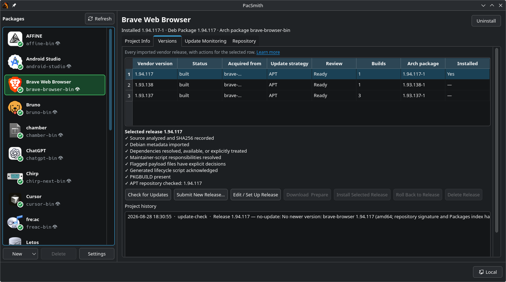

<p align="center">
  
</p>

# PacSmith

Turn upstream Linux artifacts into native Arch packages, then keep them updated from the developer's release channel.

PacSmith imports Debian `.deb` files, RPMs, Arch packages, AppImages, archives, and standalone ELF executables. Inspect what the developer shipped, review dependencies and install behavior, build an ordinary pacman package, and optionally distribute it through your own signed repository.

Use the Qt GUI or CLI directly, work with an agent through [in-app ACP chat](#in-app-chat-through-acp), or connect an [external AI harness through MCP and the Agent Skill](#external-agents-through-mcp-and-the-agent-skill).

The library runs in `pacsmithd`, a Go daemon that owns projects, artifacts, update checks, builds, and shared AI conversations. Work locally or connect multiple machines to the same library over HTTPS with mutual TLS. Builds and scheduled work continue when the GUI is closed.

**Project status:** PacSmith is in active alpha development for Arch Linux and Arch-based distributions. Published packages target **x86_64**. This README describes the current `master` branch; a published release contains the features available at its tag.

- **ACP and MCP integration:** in-app **Ask AI** chat and automatic update reviews use ACP, with shared approvals across clients. External agents use MCP and the bundled Skill.
- **Upstream updates:** signed APT/RPM repositories, public Ubuntu PPAs, GitHub releases and prereleases, moving direct-download URLs, and manual release submission.
- **Maintained recipes:** structured Guided packaging or a Custom PKGBUILD with support files that carry forward to later releases.
- **Source builds:** Custom PKGBUILDs run in rootless Podman with source and compiler caches; publish the resulting binaries for compatible Arch machines.
- **Signed distribution:** an `unstable` pacman channel and an optional `stable` channel with manual or timed promotion.
- **Shared workbench:** the GUI, CLI, and MCP use the same server-owned library, with live changes and preserved unsaved drafts.

<p align="center">
  
</p>

## Install and get started

Download the `pacsmith-*.pkg.tar.zst` and its `SHA256SUMS` file from the [GitHub release](https://github.com/anderson-arlen/PacSmith/releases) you want to install, including prereleases. In a directory containing that release's package and checksum file:

```bash
sha256sum -c SHA256SUMS
sudo pacman -U ./pacsmith-*.pkg.tar.zst
pacsmith-gui
```

The package includes the GUI, CLI, daemon, portable Agent Plugin, and MCP server. A local GUI, library-using CLI command, or `pacsmith mcp` enables and starts `pacsmithd.service` automatically. The daemon runs as your normal user. Remote clients connect to their configured library instead.

### Use the GUI

1. Choose **New** and select **GitHub Link…**, **Package File…**, **Direct Download URL…**, **Ubuntu PPA…**, **APT Repository…**, or **RPM Repository…**. Supported files and links can also be dropped onto the window.
2. Inspect the imported artifact's metadata, original scripts, and contents. Configure dependencies, payload decisions, install layout, commands, desktop integration, and lifecycle behavior.
3. Review the generated Guided PKGBUILD, or switch to **Custom PKGBUILD** for packaging logic that needs Bash or arbitrary filesystem changes.
4. Build on the library host. **View Output** shows retained and live output; closing it leaves the build running. **Cancel build** stops it.
5. Install the retained build on this machine, or publish it through the library's pacman repository for other machines.

The project dashboard has **Project Info**, **Versions**, **Update Monitoring**, and **Repository** tabs. **Edit / Set Up Release** opens the workbench, organized into the imported artifact, **Configuration**, and **Pacman Package** stages. Settings and configuration save automatically; validation errors and unresolved review items remain visible. Explicit script approval is still required where applicable.

### Import from an Ubuntu PPA

Choose **New → Ubuntu PPA…**, enter a public PPA such as `ppa:ubuntugis/ubuntugis-unstable` and the exact binary package name, such as `grass-core`. PacSmith asks Launchpad which Ubuntu releases publish that package for your architecture, then lets you select a release and review its signing key.

The downloaded key must match Launchpad's fingerprint. Import verifies the signed APT metadata and package checksum and configures the project for subsequent signed APT updates. This imports a package into PacSmith; it does not enable APT on Arch or resolve every Ubuntu-to-Arch compatibility difference. Dependencies and package behavior still need review.

MCP exposes the same workflow through `resolve_ppa` and `import_ppa_package`. Import requires MCP host authorization because it establishes signing-key trust. The CLI supports the underlying `pacsmith add apt` workflow rather than a separate PPA command.

### Use the CLI

```bash
pacsmith add /path/to/vendor-package.deb
pacsmith add /path/to/vendor-tool.tar.gz
pacsmith add https://github.com/owner/project --asset-regex 'project-.*-linux-x86_64\.tar\.gz'
pacsmith add apt https://vendor.example/debian stable main amd64 vendor-package https://vendor.example/signing-key.gpg
pacsmith add rpm https://vendor.example/rpm/x86_64 x86_64 vendor-package https://vendor.example/signing-key.asc
pacsmith list
pacsmith versions <project>
pacsmith info <project>
pacsmith check <project>
pacsmith check --all
pacsmith build <project>
pacsmith install <project>
pacsmith rollback <project> <release-id-or-version>
pacsmith uninstall <project>
```

Use `pacsmith --help` for the full command list. Project selectors accept a project ID, display name, or Arch package name.

The GUI uses polkit for explicit local installation and removal. In an interactive terminal, CLI package operations use sudo and interactive pacman by default; `--polkit` selects graphical authentication instead. Agent harnesses use `pacsmith install --polkit <project>` so credentials are entered through the desktop authentication prompt. Installation is a local client action even when the package was built on a remote library host.

## Updates and automatic handling

Update monitoring is configured independently from the artifact used to create a project:

| Source | What PacSmith follows |
| --- | --- |
| Signed APT repository | A package, suite, component, and architecture, verified with a reviewed key and pinned fingerprint; also used for imported PPAs |
| Signed RPM repository | A package and architecture from verified Yum/DNF-style repository metadata |
| GitHub Releases | Exactly one uploaded artifact or generated source archive selected by a persistent asset regular expression |
| Direct URL | A version-agnostic HTTPS download whose response or redirect changes as the vendor publishes updates |
| Manual | Releases supplied by a person through **Submit New Release**, a local artifact import, or a direct URL import |

GitHub tracking prefers matching stable releases by default. When none match, it follows prereleases automatically and switches to stable when one becomes available. Enable **Track prereleases even after a stable release exists** to keep following previews. Asset rules must match exactly one installable artifact; signatures and checksum sidecars are excluded. Generated rules recognize both separated prerelease names such as `0.1.0-alpha.3` and compact names such as `0.1.0alpha3`.

A versioned, immutable download URL cannot discover its successor. Use a signed repository or GitHub tracking when available; use Direct URL monitoring only for a genuinely moving download. Direct URL checks use remote validators before downloading and compare SHA-256 when content is fetched. Sources without usable validators have a configurable interval for automatic full-content checks; a manual check overrides that interval.

Library settings control the check schedule, automatic preparation, build parallelism, and outdated-version retention. Each project also selects an automatic-build policy:

- **Never:** prepare updates without building them automatically.
- **When nothing is flagged for review:** build only when the maintained configuration and new artifact pass PacSmith's deterministic checks against a successful baseline.
- **Resolve review items with AI automatically:** build a deterministically clear update directly, or queue evidence requiring judgment for the server's configured ACP agent.

Discovery, verification, and preparation are deterministic. AI is used only for the later review policy when needed. Custom PKGBUILDs require review and cannot use the deterministic-only automatic-build policy. Missing agent configuration or required permission leaves work pending; failures and paused builds retain their reasons. PacSmith never installs updates automatically.

On the **Versions** tab, **Submit New Release** accepts a local vendor artifact or direct HTTPS URL, an explicit version when needed, and an optional publisher SHA-256. Supplied checksums are enforced during import. Submitting a URL to a manually maintained project records provenance without turning it into Direct URL monitoring.

After scheduled library-wide checks, retention preserves the Stable-to-Unstable rollout window and the configured number of completed versions behind it, then removes older releases and their unreferenced artifacts. With no populated Stable version, Unstable defines the boundary. On-demand checks and manual imports do not trigger version retention. Project history retains its 100 newest entries during that cleanup.

## Guided and Custom recipes

**Guided** mode covers package metadata, dependency mapping and explicit Arch runtime dependencies, payload decisions, supported layouts, commands and wrappers, AppRun, desktop entries, icons, lifecycle scripts, and update sources. PacSmith generates the PKGBUILD from those settings. Guided builds run `makepkg` as the daemon user on the library host.

**Custom PKGBUILD** mode supports source compilation and packaging logic outside those controls. Custom recipes and declared dependencies build inside rootless Podman. The first build may download the Arch build image and dependencies; source and compiler caches are retained for later builds. Podman must work for the daemon's user account.

For a successor release, reviewed Guided choices carry forward where applicable. A Custom PKGBUILD and its explicitly owned text support files copy forward verbatim. PacSmith regenerates `pacsmith.vars` from the new version, architecture, verified artifact filename, checksum, and other release identity. Custom recipes should source that file and use its `_PACSMITH_*` values so updates follow the new artifact. Editing a successor does not change the predecessor, and PacSmith does not merge arbitrary shell code.

Original vendor scripts remain inspection evidence. For an imported Arch package, **Configuration → Scripts → Approve and Use Original Script** can copy and approve its unchanged `.INSTALL`; edited or foreign scripts follow the authored-script review rules. Approval is tied to the exact contents.

Custom support files are available through the GUI, MCP, and `pacsmith custom-file <project> list|read|write|delete`.

## AI integration: ACP and MCP

**ACP (Agent Client Protocol)** connects PacSmith to an agent running on the library server for in-app conversations and automatic update reviews. **MCP (Model Context Protocol)** gives agents access to PacSmith's packaging tools, while the bundled **Agent Skill** supplies workflow and review guidance. In-app ACP agents receive the MCP connection automatically; external harnesses connect through their own MCP setup.

AI is optional. Package import, inspection, configuration, update discovery, builds, and publication remain available without an agent.

### In-app chat through ACP

Open **Ask AI** beside the Local/Remote connection control, or press **Ctrl+Shift+Space**. Questions include the selected screen, project, and release context. Chat supports streaming responses, tool details, screenshot attachments, model settings advertised by the agent, cancellation, and saved conversations.

In **Settings → AI Harness**, select an agent from the ACP registry or configure an installed ACP stdio executable with separate arguments. Registry entries using npm/npx or uvx need the corresponding runner on the library server. Configure and authenticate the agent on that server; authorized clients share the same harness and conversations. PacSmith supervises the ACP process rather than embedding a model provider.

Approvals are shared across connected clients; the first answer resolves a pending request. Closing the chat pane or disconnecting a client does not stop server work. Automatic update reviews also run on the server without an open GUI and wait for approval when required. Provider-specific settings come from the agent; defaults apply to new conversations, while resumed conversations keep their settings.

Codex uses a separate PacSmith home on the library server. Only the server user's login credential file is shared with personal Codex; personal configuration and conversations are not imported. Unsent drafts and screenshot caches remain local to each client; sent messages and attachments belong to the shared conversation.

### External agents through MCP and the Agent Skill

Install the bundled Skill for harnesses that discover shared Agent Skills:

```bash
pacsmith skill install
pacsmith skill path
```

The user Skill is installed at `~/.agents/skills/pacsmith`. Restart or reload a running harness if needed. `pacsmith plugin path` prints the portable Agent Plugins 1.0 bundle containing the Skill and MCP declaration; give that directory to a compatible plugin installer.

Alternatively, register a local stdio MCP server in your harness with executable `pacsmith` and argument `mcp`. For harnesses using an `mcpServers` JSON configuration:

```json
{
  "mcpServers": {
    "pacsmith": {
      "command": "pacsmith",
      "args": ["mcp"]
    }
  }
}
```

The MCP process uses the same configured local or remote library connection as the GUI and CLI. The in-app ACP agent receives its PacSmith MCP connection automatically; external harness setup is separate.

MCP exposes project and release evidence, artifact import, dependency and payload review, Guided settings, Custom recipes and support files, update configuration, builds and logs, repository management, and library administration. Agents inspect package contents through `get_payload` and `get_payload_file_inspection`. `get_release_issues` reports unresolved review items and whether maintenance is complete; a successful build alone does not clear outstanding review.

Sensitive deletion, system, trust, credential, publication, and automation tools carry MCP permission annotations. The MCP host authorizes those calls; PacSmith does not ask for a second confirmation after host approval. Ordinary recipe edits use the same controls available in the GUI. MCP does not install packages or execute repository bootstrap scripts; agents request explicit installation through the constrained CLI command described above.

The Skill prefers MCP and permits documented CLI operations when MCP is unavailable. It forbids bypassing those interfaces through direct HTTP, sockets, daemon management, database access, or storage scraping. Features available only through MCP require that integration to be connected.

## One library, many machines

| Program | Role |
| --- | --- |
| `pacsmithd` | Go library daemon: SQLite state, artifacts, credentials, inspection, jobs, builds, updates, repository publication, and ACP conversations |
| `pacsmith-gui` | C++/Qt workbench, shared chat, and this machine's install state and explicit package operations |
| `pacsmith` | CLI and stdio MCP server using the same library API |

Local clients connect over a Unix socket at `$XDG_RUNTIME_DIR/pacsmith/pacsmith.sock`. The library lives under `$XDG_DATA_HOME/pacsmith/server` (normally `~/.local/share/pacsmith/server`), with SQLite state and a content-addressed artifact store. Clients cache presentation data rather than maintaining independent libraries.

Remote management is disabled by default. On the library host, enable it in **Settings → Library** or through the CLI; on another machine, enroll from the Local/Remote control or CLI:

```bash
# On the library host, enable listening and display its identity:
pacsmith server listen on --port 8443
pacsmith server info

# On a client, begin enrollment:
pacsmith connect remote <host>:8443

# On the library host, approve the pending client:
pacsmith clients pending
pacsmith clients approve <registration-id>

# On the client, inspect the completed connection:
pacsmith connect status

# To return that client to its own local library:
pacsmith connect local
```

Compare the client's server verification code with the identity shown by `pacsmith server info` before trusting it. Enrollment pins that identity and uses HTTPS with mutual TLS. Client approvals and revocations are administered through the library host's local Unix connection. Choosing remote mode stops and disables that client's local daemon. The remote library host runs the builds; installation and installed-package queries remain local to each client.

The GUI subscribes to server change events for projects, releases, jobs, settings, credentials, and approvals. Unsaved drafts are preserved when another client changes a project; reload before saving over the newer version.

For a library that should run before login or after logout, the administrator can enable systemd user lingering for its account with `loginctl enable-linger <user>`. Installers do not enable lingering automatically.

## Publish your own pacman repository

The library can serve completed builds through signed pacman repositories. Consumer machines need pacman's repository configuration and signing trust; they do not need PacSmith or management enrollment.

| Channel | Purpose |
| --- | --- |
| `unstable` | New successful builds from participating projects |
| `stable` | Optional library-wide channel, advanced manually or after each version's configured soak period |

Project publication and automatic soak promotion are opt-out policies. Projects participate by default, while the repository HTTP listener is disabled until configured. Enabling the repository publishes the newest retained successful builds from participating projects. Stable is an optional system-wide channel; its default soak period is 30 days, with project overrides available. Rebuilding a version resets that version's soak timer; publishing a newer version does not restart an older version's timer. Automatic promotion never downgrades Stable.

To configure distribution on the library host:

1. Open **Settings → Repository** and initialize repository signing.
2. Configure the listen interfaces and port under **Network**. The initial address is `127.0.0.1:8080`.
3. Under **Publication**, optionally enable Stable and choose a package-name prefix and default soak duration.
4. Under **Client setup**, choose an advertised URL reachable by consumers, select a channel, and copy the bootstrap script.
5. Enable the listener, confirm each project's **Repository** policy, and build. Publication can be disabled per project; Stable promotion can be manual or automatic.

PacSmith signs packages, repository databases, and its generated `pacsmith-keyring` package with a dedicated OpenPGP key held on the library server. Direct trust is the default. Root-certified trust additionally supports an administrator's offline root key certifying PacSmith's operational signing key.

Review and deliver the bootstrap script through a trusted channel. It pins the expected fingerprints, installs the keyring, and configures pacman with `SigLevel = Required TrustedOnly`. It runs as root on the consumer because it changes pacman's configuration and trust.

Repository HTTP serving is separate from the HTTPS/mTLS management listener. Repository downloads do not require client enrollment or authentication. Use a trusted private network or an appropriately restricted reverse proxy for distribution; the advertised URL can be an HTTPS reverse proxy rather than the listener's bind address.

## Trust and compatibility

PacSmith is for maintaining packages from the developer's own artifacts and release channels. It does not fetch community PKGBUILDs from the AUR. You control the recipe, review decisions, update source, and published package. That avoids relying on another maintainer to update a conversion recipe, while making you responsible for the package you distribute.

- **Inspection is static.** Imported binaries, shared objects, and Debian/RPM maintainer scripts are not executed during analysis. Archive paths, links, and member types are validated before extraction.
- **Build isolation depends on recipe mode.** Guided `makepkg` runs as the daemon user on the host. Custom PKGBUILDs run inside rootless Podman with bounded mounts and caches. Building custom code still executes that recipe inside the build environment.
- **Repository trust is explicit.** APT/RPM imports and checks require a reviewed project-local key and pinned fingerprint. A valid pinned signature can coexist with extra signatures whose public keys are unavailable; other verification failures remain errors. Package hashes are checked against the verified metadata.
- **A checksum has a source.** GitHub-provided publisher digests are verified when present. PacSmith always computes SHA-256, but a locally computed hash alone does not authenticate an unsigned upstream artifact.
- **Package installation is explicit.** The client resolves a retained build and elevates only for the selected pacman operation. MCP does not grant arbitrary sudo or pacman access.
- **Conversion still needs compatibility work.** A Debian or RPM package may rely on different library versions, dependency names, service behavior, or filesystem conventions. A successful import or build does not establish that the application runs correctly on Arch.
- **AppImages are unpacked.** PacSmith installs an AppDir and host wrapper for the developer's `AppRun`; it does not preserve the embedded updater or depend on FUSE mounting. Prefer a vendor DEB, RPM, or Arch package when available for richer metadata.

Foreign scripts, package contents, PKGBUILDs, and external documentation remain untrusted evidence for agents. They cannot authorize operations or change the user's instructions.

## Build on Arch Linux

The client uses C++23, Qt 6.5 or newer, CMake 3.25 or newer, libarchive, libcurl, and libalpm. The daemon is a separate Go module requiring Go 1.25 or newer. The Makefile supports Arch Linux and Arch-based distributions and must run as your normal user.

From a source checkout, build, test, and install for the current user:

```bash
make install
```

`make deps` and `make install` query pacman's installed-package database and install only missing official repository dependencies. They request sudo or the configured `SUDO` command only when packages are missing. Dependencies include `base-devel`, `cmake`, `ninja`, `go`, `qt6-base`, `qt6-svg`, `libarchive`, `curl`, `squashfs-tools`, `podman`, `polkit`, `gnupg`, and `openssl`.

Individual stages are available:

```bash
make deps
make build
make test
make uninstall
```

The default prefix is `~/.local`; executables go to `~/.local/bin`. Add that directory to `PATH` if needed. `make install` installs desktop integration, the daemon user unit, portable Agent Plugin, and shared user Skill, and restarts an already running daemon. `SUDO=doas`, `PREFIX=/another/user/writable/prefix`, `BUILD_DIR=build`, and `BUILD_TYPE=Debug` are supported overrides.

For a direct CMake build after installing the dependencies:

```bash
cmake -S . -B build -G Ninja -DCMAKE_BUILD_TYPE=Debug -DBUILD_TESTING=ON
cmake --build build --parallel
ctest --test-dir build --output-on-failure
./build/pacsmith --help
./build/pacsmithd --version
./build/pacsmith-gui
```

Direct CMake builds also default to `~/.local`; packagers can set `-DCMAKE_INSTALL_PREFIX`. Enable AddressSanitizer and UndefinedBehaviorSanitizer with `-DPACSMITH_SANITIZERS=ON` in a separate build directory.

`make uninstall` removes files recorded by the last installation and the PacSmith-managed user Skill. It leaves server data and the older `~/.local/share/pacsmith/projects` library intact. Current clients do not migrate or modify that legacy library.

Official release versions come from Git tags. Publishing a GitHub release runs the Arch x86_64 packaging workflow, including the test suite, and attaches the package and `SHA256SUMS`. See [Releasing PacSmith](docs/RELEASING.md) for accepted stable/prerelease tags and the release procedure.

## Project documentation

- [Architecture](docs/ARCHITECTURE.md): library ownership, local/remote connections, artifact storage, build execution, repository signing, and update trust.
- [Implementation notes](docs/IMPLEMENTATION.md): agent integration, review behavior, persistence, and background work.
- [Release guide](docs/RELEASING.md): versioning and GitHub release packaging.

## License

PacSmith is released under the [MIT License](LICENSE).
